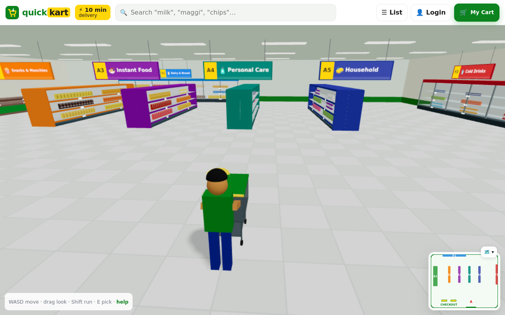
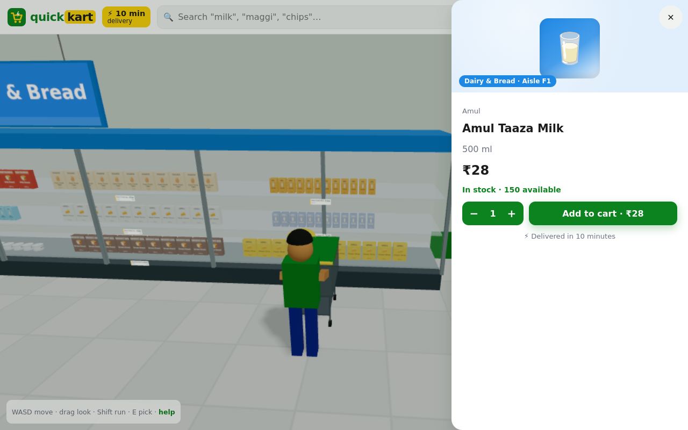
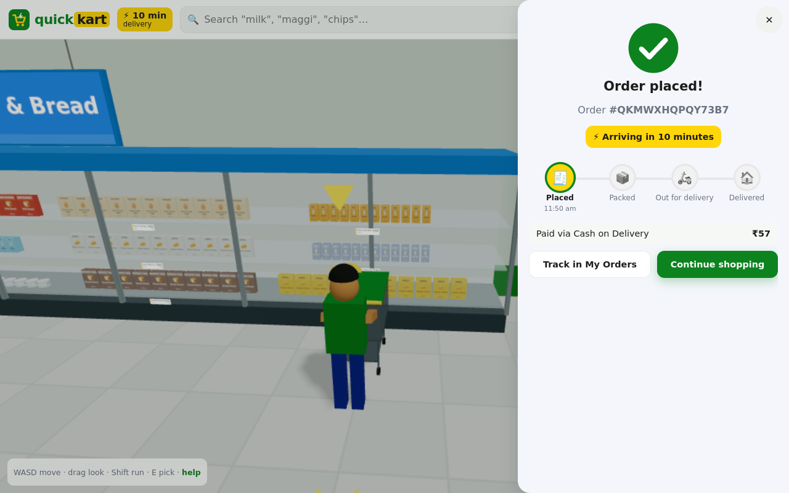
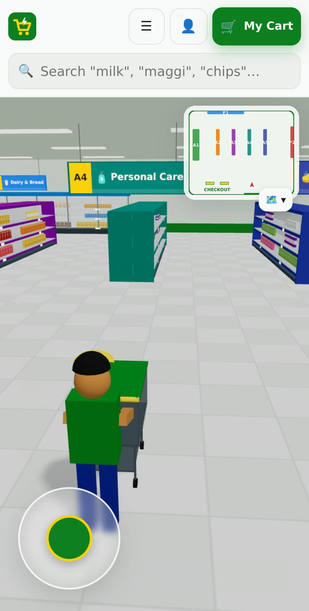
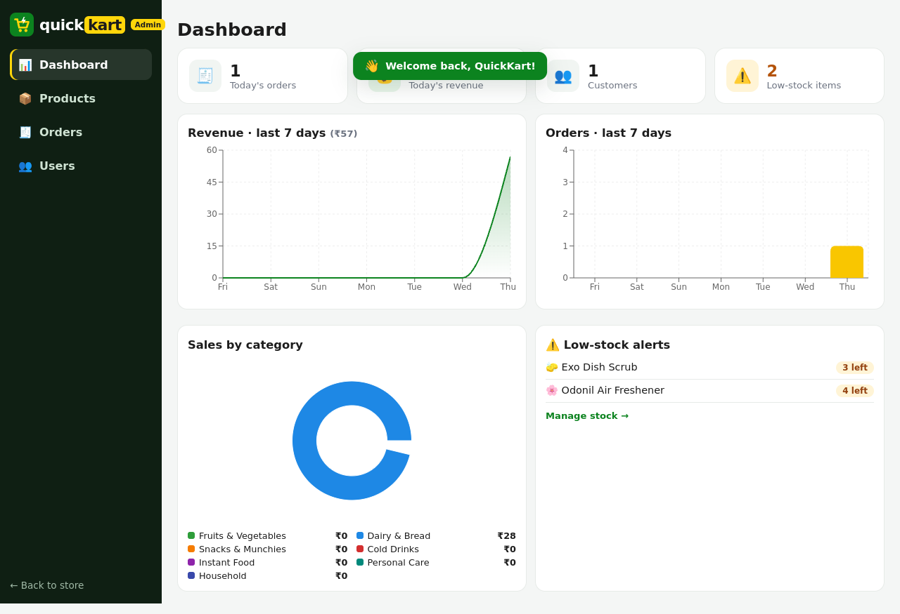

# QuickKart 3D 🛒⚡

**Walk through a 3D supermarket, pick groceries off the shelves, and check out for 10-minute delivery.**
QuickKart 3D is a full-stack quick-commerce demo (in the style of Indian 10-minute grocery apps) with its own brand, built by **Yashwant Jaiswal** as a portfolio project.

> Demo only: no real payments are taken and no real deliveries happen.



| Product pickup | Order placed | Mobile | Admin |
|---|---|---|---|
|  |  |  |  |

_Screenshots placeholder: replace with fresh captures from the live site._

## Features

**3D store (React Three Fiber)**
- Bright supermarket interior with 4 gondola aisles, a produce stand, two glass-door fridge sections, hanging category signs, ceiling lights, entrance doors and 2 checkout counters with cashiers. Everything is low-poly procedural geometry, so no model downloads are needed.
- ~1,200 instanced product packs (boxes, bottles, cans, jars, fruit) with canvas-texture labels and shelf price tags (name, ₹ price, MRP).
- Third-person shopper pushing a cart: **WASD / arrows**, **mouse drag** to look, **Shift** to run, **E** to pick. On touch devices there is an on-screen **joystick** and drag to look. Collision with shelves, counters and walls.
- Hover or aim highlights a product. Click, tap or press E to open a product card (price, MRP strike-through, discount %, stock, qty), then **Add to cart**: the item flies into the 3D cart and stacks inside it, with a toast like "+1 Amul Taaza Milk".
- Search with **A\* path guidance** (yellow floor arrows, a floating arrow and a beacon) or ⚡ teleport to the aisle. A mini-map shows the aisles, your position and the route.
- Walk to a checkout counter (or tap the cart) to open checkout.
- Loading screen with progress, a first-visit controls overlay, adaptive DPR, and an automatic **2D list view fallback** when WebGL is unavailable (you can also toggle it manually).

**Shopping**
- Guest cart in localStorage. Login is required to order, and the guest cart merges into the account cart after login.
- Checkout: qty edit/remove, bill details (item total, delivery ₹25 (free above ₹199), handling ₹4, total savings), saved addresses, Cash on Delivery or a clearly labelled **Demo UPI** (no payment).
- Success animation with order ID, a 10-minute ETA and a live status tracker (Placed → Packed → Out for delivery → Delivered). The server advances it over time, or the admin can change it.
- My Orders page with history, detail, tracker and cancel (while still "Placed").

**Admin (`/admin`, admin role only)**
- KPI cards (today's orders and revenue, customers, low-stock count), 7-day revenue and orders charts, sales by category (recharts), and low-stock alerts.
- Products CRUD with search, category/status filters, pagination and an active toggle.
- Orders list with status/search/date filters, an order detail drawer and status updates (reflected on the customer's tracker), plus CSV export.
- Users list with block/unblock.

**Security**
- bcrypt (12 rounds) passwords with strength rules. JWT in an `httpOnly`, `SameSite=Strict` cookie (`Secure` in production), with a Bearer fallback.
- helmet with a strict CSP, a same-origin API (no CORS) and an Origin check on mutating requests.
- express-rate-limit on auth, orders and the general API. **zod** validation on every input, express-mongo-sanitize, and a 20 KB body limit.
- **Prices and totals are always recalculated server-side from the DB.** Stock is decremented atomically with a conditional update and rollback (no overselling).
- Ownership checks (other users' orders return 404), an admin-only middleware, generic error messages, no stack traces in production, and CSV formula-injection guarding.

## Stack
Vite + React 18, three.js, @react-three/fiber, @react-three/drei, framer-motion, zustand, react-router, recharts ·
Node.js + Express 4, Mongoose (MongoDB), bcryptjs, jsonwebtoken, helmet, express-rate-limit, zod.
One repo, one web service: Express serves the API at `/api` and the built frontend from `dist/`.

## Run locally
```bash
npm install
cp .env.example .env      # optional; set ADMIN_EMAIL / ADMIN_PASSWORD for an admin account
npm run build             # builds the frontend into dist/
npm start                 # http://localhost:4000
```
Without `MONGODB_URI` the server uses a local JSON store (`server/.data/db.json`), so it runs with zero setup.
For frontend hot reload, run `npm run dev:server` and `npm run dev` (Vite on :5173 proxies `/api` to :4000).

## Environment variables
| Var | Purpose |
|---|---|
| `MONGODB_URI` | MongoDB connection string (database `quickkart`). Empty means the local JSON store. |
| `JWT_SECRET` | Long random string (required in production). |
| `ADMIN_EMAIL`, `ADMIN_PASSWORD` | Admin account upserted on start (bcrypt). Never commit these. |
| `NODE_ENV` | `production` enables secure cookies and hides error details. |
| `PORT` | Default 4000. |
| `AUTH_RATE_LIMIT`, `ORDER_RATE_LIMIT` | Optional: requests per 15 min per IP (defaults 20 / 30). |

On start the server seeds 64 products **only if the products collection is empty** (it never wipes data), creates the demo user if missing, and upserts the admin from env.

## Demo account
`demo@quickkart.dev` / `Demo@1234` (a normal shopper, safe to share). There is also a "Use demo account" button on the login form.

## Tests
```bash
BASE_URL=http://localhost:4000 ADMIN_EMAIL=... ADMIN_PASSWORD=... npm run test:api
```
36 checks: register/login, wrong password → 401, NoSQL injection, product list, tampered client price ignored, bill maths, overselling → 409, qty limits, cross-user order access → 404, non-admin → 403, admin status update reflected for the user, CSV export, blocked users, body limit, cross-origin POST, CSP header and auth rate limit → 429.
`scripts/ui-smoke.mjs` is an optional Playwright smoke test (3D canvas, pickup, checkout, mobile overflow, admin).

## Project structure
```
server/            Express app, routes, middleware, Mongo + JSON repositories, seed data
src/three/         3D store: layout + path-finding, fixtures, instanced products, player/cart, guide
src/ui/            HUD, product card, checkout, orders, auth, list view
src/admin/         Admin dashboard
scripts/           API test + optional UI smoke test
```

---
Built by **Yashwant Jaiswal**. All brand names of products are used only as realistic sample catalogue data. QuickKart is a fictional brand.
